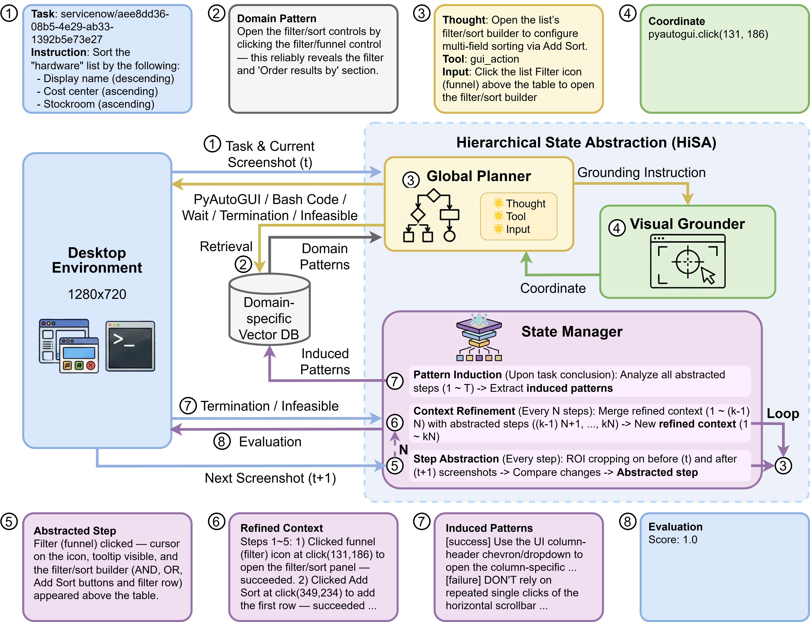

# HiSA: Hierarchical State Abstraction for Scalable GUI Agents

## Updates

- 2026-04-06: Accepted by ACL 2026 Findings 🎉

This repository contains the code for the paper [*HiSA: Hierarchical State Abstraction for Scalable GUI Agents*](https://aclanthology.org/2026.findings-acl.581/).

**Authors:** Weiming Li, Hye-young Paik, and Yulei Sui

## 📖 Introduction

Multimodal GUI agents generally operate on raw visual and textual observations, creating a fundamental scalability challenge. While current state-of-the-art frameworks predominantly rely on inference-intensive test-time scaling or the accumulation of unbounded raw logs to maintain task coherence, we attribute the underlying bottleneck to the lack of effective state abstraction.
To address this, we introduce Hierarchical State Abstraction (HiSA), a framework that prioritizes active knowledge restructuring over passive history retention by transforming raw history into a three-level hierarchy of Step Abstracts, Refined Context, and Induced Patterns.
By synthesizing high-dimensional observations into these compact semantic states, HiSA decouples reasoning efficacy from context length.
On the Spider2-V benchmark, our method establishes a new state-of-the-art with a 40.58\% success rate while reducing token consumption by 69.85\% and monetary costs by 55.10\% compared to the best-performing baseline.

## 🏗️ Architecture

<div align="center">

</div>

The HiSA framework decouples the agent architecture into three specialized modules.

* **Global Planner**
This module serves as the high-level reasoning engine utilizing a unified multimodal context.
* **Visual Grounder**
This module maps semantic descriptions to precise pixel coordinates.
* **State Manager**
This module orchestrates the abstraction logic and restructures context through Step Abstraction, Context Refinement and Pattern Induction.

## 📊 Performance

HiSA establishes a new state-of-the-art on the Spider2-V benchmark with a 40.58% success rate while reducing token consumption by 69.85% compared to the best-performing baseline.

### 🕷️ Spider2-V Abstract Subset

| Method | LLM Backbone | Max Steps | SR (%) | Cost ($) | Tokens Total (K) | Tokens Input (K) | Tokens Output (K) | Steps |
| --- | --- | --- | --- | --- | --- | --- | --- | --- |
| Spider2-V Agent | GPT-4V | 15 | 11.30 | - | - | - | - | - |
| CoAct-1 | GPT-5 | 50 | 23.67 | 0.75 | 526.25 | 472.74 | 53.51 | 28.84 |
| GTA1 | GPT-5 | 50 | 31.72 | 3.79 | 1115.30 | 835.94 | 279.37 | 26.17 |
| Agent S3 | GPT-5 | 50 | 38.96 | 0.98 | 607.18 | 575.89 | 31.29 | 23.82 |
| **HiSA (Ours)** | **GPT-5** | **50** | **40.58** | **0.44** | **183.05** | **141.30** | **41.75** | **15.34** |
| Human | - | - | 47.66 | - | - | - | - | 10.98 |

### 🖥️ OSWorld

| Method | LLM Backbone | Success Rate @ 50 Steps | Success Rate @ 100 Steps |
| --- | --- | --- | --- |
| UI-TARS-1.5-7B | UI-TARS-1.5-7B | - | 27.4% |
| Agent S2 | Gemini-2.5-Pro | 45.8% | - |
| Agent S2 | GPT-5 | 46.3% | 48.8% |
| Jedi-7B | o3 | 50.6% | 51.0% |
| GTA1-7B | o3 | 48.6% | 53.1% |
| Agent S2.5 | o3 | 54.2% | 56.0% |
| GTA1-32B | o3 | - | 55.4% |
| CoAct-1 | o3 | 56.4% | 59.9% |
| Agent S2.5 | GPT-5 | - | 58.4% |
| GTA1-7B | GPT-5 | - | 61.0% |
| GTA1-32B | GPT-5 | - | 62.0% |
| Agent S3 | GPT-5 | 61.1% | 62.6% |
| Agent S3 w/ bBoN | GPT-5 | 63.5% | 69.9% |
| **HiSA (Ours)** | **GPT-5** | **58.7%** | **59.3%** |

## 🛠️ Installation

This tutorial is verified on Windows only. 

Please create a conda environment and install the dependencies using the following commands.
```bash
conda create -n hisa python=3.11
conda activate hisa
pip install -r requirements.txt
```

Please configure the OpenAI API key environment variable before running the agent.
```bash
export OPENAI_API_KEY=your_api_key
```

## 🚀 Model Deployment

### Vector Database and Embedding

We recommend setting Qdrant to server mode to support multiple environments as local settings only support a single environment. Please refer to the official documentation for configuration.

[https://github.com/qdrant/qdrant](https://github.com/qdrant/qdrant)

For the BGE-M3 embedding service please refer to the FlagEmbedding guide.

[https://github.com/FlagOpen/FlagEmbedding](https://github.com/FlagOpen/FlagEmbedding)

Start the embedding service with the following script.
```bash
python embedding.py
```

### Local VLM Deployment

Run the local model servers in a separate environment from the `hisa` agent environment to avoid dependency conflicts. Create and activate a dedicated environment, then install vLLM:

```bash
conda create -n hisa-vllm python=3.11 -y
conda activate hisa-vllm
pip install vllm
```

Download the model parameters for UI-TARS-1.5-7B and GTA1-7B from HuggingFace.

* [https://huggingface.co/ByteDance-Seed/UI-TARS-1.5-7B](https://huggingface.co/ByteDance-Seed/UI-TARS-1.5-7B)
* [https://huggingface.co/HelloKKMe/GTA1-7B](https://huggingface.co/HelloKKMe/GTA1-7B)

Launch the GTA1-7B server.
```bash
python -m vllm.entrypoints.openai.api_server --served-model-name gta1-7b --model /path/to/GTA1-7B --port 1234
```

Launch the UI-TARS-1.5-7B server.
```bash
python -m vllm.entrypoints.openai.api_server --served-model-name uitars-1.5-7b --model /path/to/UI-TARS-1.5-7B --port 1235
```

## ⚡ Environment Setup

Run the automated setup script:
```bash
./scripts/setup_benchmarks.sh
```

This will:
1. Clone Spider2-V and OSWorld repositories
2. Copy the benchmark-specific HiSA adapters from the `setup/` directory

### Spider2-V Setup

We primarily evaluate performance on the Abstract subset of Spider2-V while excluding 40 tasks involving DBT and BigQuery due to 2FA constraints. Please refer to the official github for the initial environment setup.

[https://github.com/xlang-ai/Spider2-V](https://github.com/xlang-ai/Spider2-V)

For ServiceNow tasks please use the new configuration method from WorkArena as the original Spider2-V setup is deprecated. Follow the instruction below.

[https://github.com/ServiceNow/WorkArena](https://github.com/ServiceNow/WorkArena)

The setup script copies the HiSA integration files from `setup/Spider2-V/` to `benchmarks/Spider2-V/`.

| File | Modification Scope |
| --- | --- |
| **run_hisa.py** | Runs HiSA directly on Spider2-V without the multi-method `run_all.py` entrypoint, including task filtering, resolution control, result reuse, and score reporting. |
| **run_all.py** | Registers HiSA and baseline methods, applies resolution control in the method runner, filters tasks, and writes evaluation outputs. |
| **desktop_env/controllers/python.py** | Adds `run_python_script` and `run_bash_script` helpers on top of Spider2-V's existing `/execute` endpoint. |
| **evaluation_examples/test_abstract.json** | Defines the Spider2-V Abstract evaluation subset used by this repository. |

Configure the VM and snapshot according to upstream Spider2-V, then pass the selected snapshot with `--snapshot_name` when running the adapter.

### OSWorld Setup

We run OSWorld in Docker rather than VMware. Follow the [official OSWorld setup](https://github.com/xlang-ai/OSWorld) to prepare the benchmark credentials and download the OSWorld-Verified Ubuntu qcow2 image.

The host must have Docker and KVM available. Verify them before starting an evaluation:

```bash
docker info
test -e /dev/kvm && echo "KVM is available"
```

Place the downloaded image at the default location:

```text
benchmarks/OSWorld/Ubuntu.qcow2
```

If the image is stored elsewhere, pass its absolute path through `PATH_TO_VM` when launching HiSA. The launcher creates and manages the OSWorld Docker containers automatically; there is no need to run the VM container manually.

The `setup/OSWorld/` directory contains the HiSA runner shown below. `scripts/setup_benchmarks.sh` copies it into the corresponding location in the OSWorld checkout.

| File | Modification Scope |
| --- | --- |
| **scripts/python/run_multienv_hisa.py** | Connects HiSA to OSWorld's multi-environment execution flow, distributes tasks across workers, manages per-task outputs, configures the requested resolution, and reports official OSWorld results. |

## 🏃 Usage

We provide benchmark-specific adapters for HiSA and launcher scripts for common configurations.

Run HiSA on Spider2-V with the standalone adapter (from the repository root):

```bash
cd benchmarks/Spider2-V
python run_hisa.py \
  --path_to_vm vm_data/Ubuntu0/Ubuntu0/Ubuntu0.vmx \
  --snapshot_name config \
  --global_planner_model gpt-5 \
  --state_manager_model gpt-5-mini \
  --visual_grounder_model gta1-7b \
  --use_qdrant_server \
  --max_steps 50 \
  --result_dir results/hisa_gpt5_gta1_50 \
  --test_all_meta_path evaluation_examples/test_abstract.json \
  --headless
```

The adapter supports `--domain`, `--rerun`, `--rerun_fail`, and `--get_score`. It runs HiSA only; `run_all.py` remains available for baseline methods.

Run HiSA on OSWorld with the Docker launcher. With the qcow2 image in the default location:

```bash
./scripts/run_hisa.sh
```

If the image is stored elsewhere, or if multiple environments are required:

```bash
PATH_TO_VM=/absolute/path/to/Ubuntu.qcow2 \
NUM_ENVS=2 \
./scripts/run_hisa.sh
```

`NUM_ENVS` defaults to `1`. Each worker creates its own OSWorld Docker environment. Pattern memory uses the Qdrant server configured by `--use_qdrant_server`, so start Qdrant before launching a multi-environment run.

After starting the OSWorld launcher, you can check the current score at any time by running:

```bash
python agents/utils.py \
  --result_dir results/hisa_gpt5_gta1_50 \
  --test_all_meta_path benchmarks/OSWorld/evaluation_examples/test_all.json
```

If you override `RESULT_DIR` or pass a different `--test_all_meta_path` to the launcher, use the same paths in the summary command.

Run Baseline such as GTA1:
```bash
./scripts/run_gta1.sh
# ... other baseline scripts available in scripts/
```

## 🧩 Acknowledgements

We incorporate specific prompts regarding software operation guidelines from [Agent S3](https://github.com/simular-ai/Agent-S). Additionally, the bash code execution logic is adapted from [CoAct-1](https://github.com/SalesforceAIResearch/CoAct-1).

## 📚 Citation

If you find HiSA useful, please cite our paper:

```bibtex
@inproceedings{li-etal-2026-hisa,
    title = "{H}i{SA}: Hierarchical State Abstraction for Scalable {GUI} Agents",
    author = "Li, Weiming  and
      Paik, Hye-young  and
      Sui, Yulei",
    editor = "Liakata, Maria  and
      Moreira, Viviane P.  and
      Zhang, Jiajun  and
      Jurgens, David",
    booktitle = "Findings of the {A}ssociation for {C}omputational {L}inguistics: {ACL} 2026",
    month = jul,
    year = "2026",
    address = "San Diego, California, United States",
    publisher = "Association for Computational Linguistics",
    url = "https://aclanthology.org/2026.findings-acl.581/",
    doi = "10.18653/v1/2026.findings-acl.581",
    pages = "11965--11985",
    ISBN = "979-8-89176-395-1"
}
```
